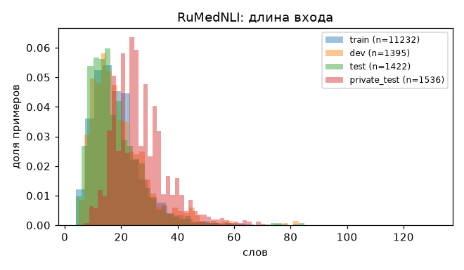
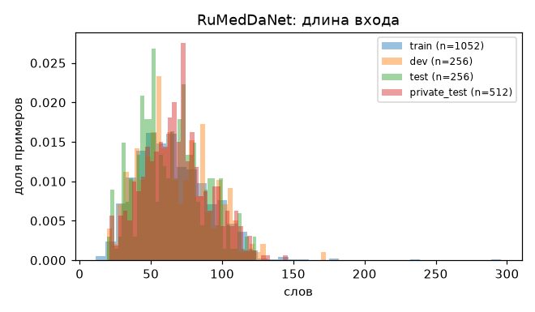
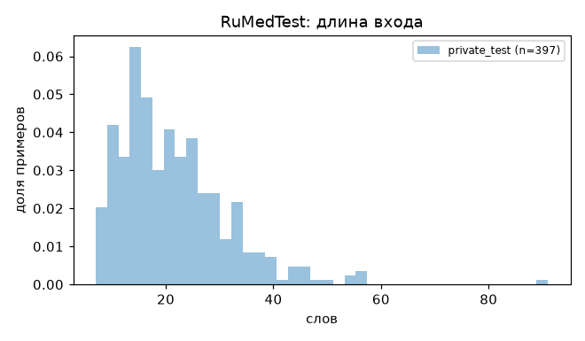
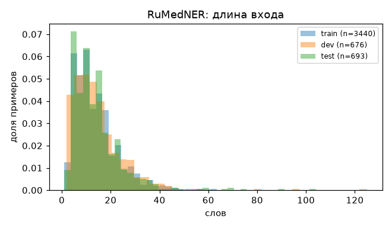
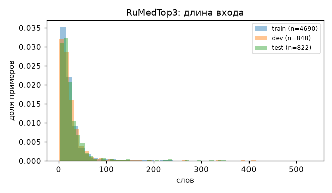
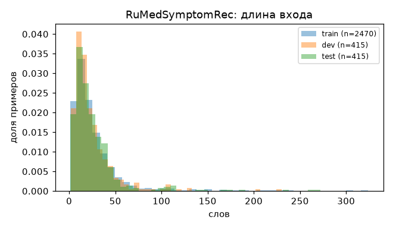

# Статистика RuMedBench

Открытый репозиторий `sb-ai-lab/MedBench @ dd57f4f`. Сгенерировано командой `uv run medbench data stats`. Длины — в словах (по пробелам) суммарно по входным полям.

## Размеры сплитов

| Задача | train | dev | test | private_test |
|---|---|---|---|---|
| RuMedNLI | 11232 | 1395 | 1422 | 1536 |
| RuMedDaNet | 1052 | 256 | 256 | 512 |
| RuMedTest | — | — | — | 397 |
| RuMedNER | 3440 | 676 | 693 | — |
| RuMedTop3 | 4690 | 848 | 822 | — |
| RuMedSymptomRec | 2470 | 415 | 415 | — |

Сверка со статьёй (таблица 1): все размеры совпадают.

## RuMedNLI

NLI (entailment / contradiction / neutral), посылка + гипотеза

| Сплит | Примеров | Классов | Длина min / median / p95 / max | Метки (top) |
|---|---|---|---|---|
| train | 11232 | 3 | 4 / 17 / 35 / 131 | entailment: 3744, contradiction: 3744, neutral: 3744 |
| dev | 1395 | 3 | 5 / 17 / 41 / 83 | entailment: 465, contradiction: 465, neutral: 465 |
| test | 1422 | 3 | 4 / 16 / 35 / 85 | entailment: 474, contradiction: 474, neutral: 474 |
| private_test | 1536 | — | 7 / 25 / 45 / 71 | — |

Примеры:

- Анализы отличались содержанием креатина 1,7 (исходный уровень 0,5 по старым записям) и лактата 2,4. ‖ У пациента повышен креатин → **entailment**
- Боли в области поясничного отдела позвоночника наблюдаются с юности. Периодически проходил консервативное лечение у невролога без достижения существенного эффек… ‖ Жалуется на сухой кашель, насморк, боли в горле.

## RuMedDaNet

бинарный QA (да / нет) по контексту

| Сплит | Примеров | Классов | Длина min / median / p95 / max | Метки (top) |
|---|---|---|---|---|
| train | 1052 | 2 | 11 / 62 / 108 / 296 | да: 526, нет: 526 |
| dev | 256 | 2 | 19 / 63 / 107 / 173 | да: 128, нет: 128 |
| test | 256 | 2 | 19 / 63 / 105 / 124 | да: 128, нет: 128 |
| private_test | 512 | — | 21 / 67 / 109 / 146 | — |

Примеры:

- Способность к адаптации сенсорной системы к постоянной силе длительно действующего раздражителя заключается в основном в понижении абсолютной и повышении диффер… ‖ Является ли сниженние абсолютной чувствительности рецепторов одним из основных способов адаптации сенсорной системы? → **да**
- Природа полос поглощения в ик-области связана с колебательными переходами и изменением колебательных состояний ядер, входящих в молекулу поглощающего вещества.… ‖ Возможности ИК-спектроскопии позволяют анализировать вещества в кристаллическом состоянии?

## RuMedTest

тест по общей врачебной практике, 4 варианта, 1 верный (меток нет)

| Сплит | Примеров | Классов | Длина min / median / p95 / max | Метки (top) |
|---|---|---|---|---|
| private_test | 397 | — | 7 / 20 / 39 / 91 | — |

Примеры:

- "Критическим" считается уменьшение площади левого атриовентрикулярного отверстия до ‖ 3 см2 ‖ 2 см2 ‖ 4 см2 ‖ 1 см2 и менее

## RuMedNER

NER, IOB-разметка 6 типов сущностей

| Сплит | Примеров | Классов | Длина min / median / p95 / max | Метки (top) |
|---|---|---|---|---|
| train | 3440 | 6 | 1 / 12 / 32 / 105 | DI: 995, Drugname: 736, Drugform: 615, ADR: 525, Drugclass: 232, Finding: 158 |
| dev | 676 | 6 | 2 / 12 / 31 / 125 | DI: 210, Drugname: 152, Drugform: 108, ADR: 104, Drugclass: 51, Finding: 35 |
| test | 693 | 6 | 1 / 12 / 32 / 104 | DI: 196, Drugname: 155, Drugform: 113, ADR: 91, Drugclass: 47, Finding: 43 |

Примеры:

- Орвирем как многие лекарственные средства , нам выписала врач педиатр . → **B-Drugname O O O O O O O O O O**

## RuMedTop3

классификация жалоб по кодам МКБ-10 (Acc, Hit@3)

| Сплит | Примеров | Классов | Длина min / median / p95 / max | Метки (top) |
|---|---|---|---|---|
| train | 4690 | 105 | 2 / 17 / 71 / 531 | M54: 560, I11: 249, G54: 229, E06: 166, G90: 152, G44: 132, J06: 114, G20: 112, E66: 108, N41: 91 |
| dev | 848 | 104 | 1 / 17 / 64 / 414 | M54: 87, I11: 55, G54: 37, G90: 27, G44: 27, J06: 25, E06: 23, G20: 19, E66: 18, G40: 18 |
| test | 822 | 104 | 2 / 17 / 66 / 352 | M54: 87, I11: 56, G54: 38, G90: 36, E06: 31, J06: 23, G20: 20, E04: 19, M13: 19, K29: 16 |

Примеры:

- Жалобы на болит во всех суставах но более в крупных суставах, в тенчние 2-х недель, подобное состояние было месяц назад полсе стресса на работае, все купировало… → **M17**

## RuMedSymptomRec

рекомендация недостающего симптома (Acc, Hit@3)

| Сплит | Примеров | Классов | Длина min / median / p95 / max | Метки (top) |
|---|---|---|---|---|
| train | 2470 | 141 | 1 / 19 / 75 / 324 | насморк: 41, боль в шейном отделе позвоночника: 37, сухой кашель: 36, боль в горле: 35, слабость выраженная: 33, тошнота с рвотой: 31, чихание: 31, боль в шее (с иррадиацией): 31, сонливость: 31, боли в грудной клетке: 29 |
| dev | 415 | 126 | 2 / 18 / 62 / 230 | слабость выраженная: 11, боль в эпигастрии: 11, боль в шейном отделе позвоночника: 9, потеря сознания: 8, насморк: 8, боль в области сердца: 8, головная боль в височной области: 7, ощущение комка в горле: 7, боль при движении: 6, боль в шее (с иррадиацией): 6 |
| test | 415 | 129 | 1 / 18 / 66 / 272 | сухой кашель: 8, острая боль: 8, пастозность лица: 8, повышение ад: 8, слабость выраженная: 8, озноб: 8, насморк: 8, боль в шее (с иррадиацией): 7, чихание: 7, боль за грудиной: 7 |

Примеры:

- В течение 1,5 лет - приступы  по 40 минут, судорогами, с пеной изо рта, мочеиспусканием. Принимает Депакин хрон 300 мг -2 р/сут. Снижено критичное отношение к с… → **потеря сознания**
